


 





Byte gets hungry and bored over time and sleeps at night (PKT). Her mood is real: she lives in <code>cat/state.json</code>.

<!--CAT:START-->
_No visitors yet. Be the first to say hi to Byte!_
<!--CAT:END-->




<a href="https://github.com/Zidarc?tab=overview"></a>



<code>ali@zidarc ~ $ exit</code> · <i>"The best code is the code that ships."</i>

