


 



<a href="https://github.com/Zidarc/Cyber-Loop">cyber-loop</a> · <a href="https://github.com/Zidarc/Portfolio">portfolio</a> · <a href="https://github.com/Zidarc/Ishara">ishara</a> · <a href="https://github.com/Zidarc/Zidarc">zidarc</a>


<picture>
  <source media="(prefers-color-scheme: light)" srcset="https://raw.githubusercontent.com/Zidarc/Zidarc/main/assets/cat-day.svg?v=3af50bec" />
  
</picture>

Billo gets hungry and bored over time and sleeps at night (PKT). My commits feed her too. When it rains in Karachi it rains on her walk, and if 10 people visit in a day she throws a party. Every visitor gets a pixel avatar on her wall and a sticker of their own. Her mood is real: she lives in <code>cat/state.json</code>. Rumour has it she knows a couple of secret words… 👀






<a href="https://github.com/Zidarc?tab=overview"></a>



<code>ali@zidarc ~ $ exit</code> · <i>"The best code is the code that ships."</i>

